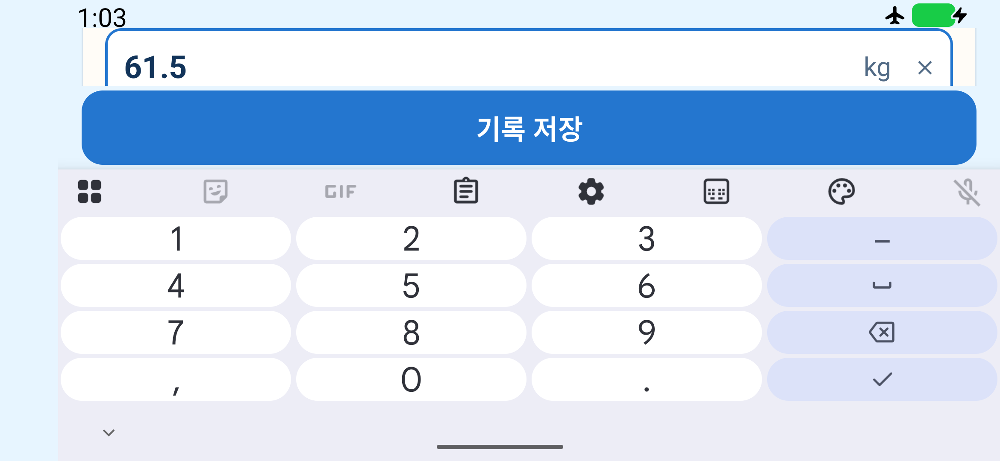
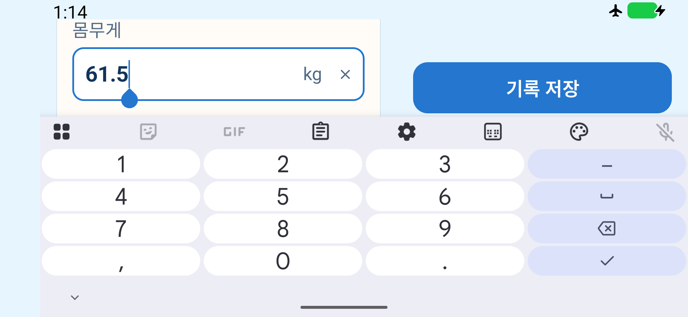

# Android 호환성 검증

이 문서는 설치 가능한 최소 버전과 실제로 검사한 환경을 구분합니다. Google Play 게시·심사와 실기기 검증은 이번 작업 범위에 포함하지 않습니다.

## 지원 범위와 변경

- 1.0.15부터 Android 11(API 30) 이상을 지원합니다. 직전 공개 APK 1.0.14는 Android 12(API 31) 이상입니다.
- 아래 검증한 개발 후보의 Android 11 지원을 1.0.15에 반영했습니다. 1.0.15의 실제 릴리즈 검사 결과는 [검증 기록](검증-기록.md)을 확인하세요. 아래 arm64 에뮬레이터 검사 범위에서 호환성 검증을 완료했습니다. `compileSdk`·`targetSdk`는 36을 유지합니다.
- Android 10(API 29)은 사용자 승인에 따라 앱 잠금만 제외하는 후보까지 구현해 조사했습니다. 집중 검사는 기본·큰 글씨 각각 4개 통과했지만 전체 기본 글씨 84개 중 6개가 실패했습니다. 키보드 복귀 2건, 1,000행 표의 메모리 부족, 연락처 조작, 위젯 시스템 테마, 녹화 파일 생성 문제입니다. API 29 이미지의 앱 힙 제한은 48MB, API 30은 192MB였습니다. 모든 실패를 앱 결함으로 단정하지 않지만 추가 환경·동작 대응이 필요하므로 이번 저비용 지원 범위에서는 제외했습니다. 이 조사 후보의 기능 분기는 최종 소스에 남기지 않았습니다.
- Android 11 이상에서는 앱 잠금·화면 보호를 모두 유지합니다. `BIOMETRIC_STRONG | DEVICE_CREDENTIAL` 인증 조합을 변경하지 않습니다. [AndroidX 인증 지원 범위](https://developer.android.com/reference/androidx/biometric/BiometricPrompt.PromptInfo.Builder)
- Android 11의 API 제약은 수량 계산의 `BigInteger.longValueExact()`와 위젯의 시스템 모서리 리소스입니다. 수량은 범위를 확인한 뒤 변환하여 넘침 예외를 보존하고, 위젯은 Android 11의 로컬 치수와 Android 12 이상의 기존 시스템 치수를 사용합니다. 큰 글씨 가로 위젯에서 제목 행이 과도한 높이를 차지하던 Android 11 문제도 수정했습니다. 큰 가로 키보드로 앱의 세로 공간이 180dp보다 작아지면 공통 페이지의 저장 영역을 옆으로 옮겨 입력란을 확보합니다. 버튼 규격과 입력 컴포넌트의 상태는 유지합니다. 라이브러리 다운그레이드·DB 이전·백업 형식 변경은 없습니다.

## 검사 범위

다음 표는 이번 최소 지원 범위를 확정하는 호환성 검사의 범위입니다. 일반 릴리즈의 필수 검사를 자동으로 이 표 전체로 확대하지 않습니다. 이후 변경은 관련 OS·기능부터 로컬에서 확인하고, 릴리즈 후보 검증은 기존 운영 가이드를 따릅니다.

| OS | API | 필수 검사 |
| --- | --- | --- |
| Android 11 | 30 | 전체 UI 기본·1.5배, 서명 APK 신규 설치, 실제 프로세스 복구, 좁은 화면 |
| Android 12 | 31 | 핵심 회귀 기본·1.5배, 서명 APK 신규 설치·기존 APK 덮어 설치 |
| Android 12L | 32 | 핵심 회귀 기본·1.5배, 서명 APK 신규 설치, 태블릿 크기·실제 창 크기 변경 |
| Android 13 | 33 | 핵심 회귀 기본·1.5배, 서명 APK 신규 설치, 알림 권한 |
| Android 14 | 34 | 핵심 회귀 기본·1.5배, 서명 APK 신규 설치, 알림 권한 |
| Android 15 | 35 | 전체 UI 기본·1.5배, 서명 APK 신규·덮어 설치, 실제 프로세스 복구 |
| Android 16 | 36 | 전체 UI 기본·1.5배, 서명 APK 신규 설치 |
| Android 17 | 37 | 전체 UI 기본·1.5배, 서명 APK 신규·덮어 설치, 실제 프로세스 복구, 태블릿 크기·실제 창 크기 변경 |
| Android 16 / 16KB | 36 | 실제 페이지 크기 16384 확인, 서명 APK 설치·기록·백업·권한 |

각 일반 OS에서 별도 캘린더 권한 거절 검사도 수행합니다. 핵심 회귀의 정확한 메서드 목록은 `scripts/test-compatibility.py`의 `CORE`이며 실행 결과에 예상 이름과 실제 이름을 함께 저장합니다. 전체 UI는 기존 12개 클래스의 전체 메서드를 대상으로 합니다. 숫자는 고정 통과 기준이 아니며 소스에서 다시 계산합니다.

밝게·어둡게, 회전, 입력·저장·키보드, 초안, 재고, 일정, 잠금·화면 보호, 위젯을 기존 UI 검사로 확인합니다. 실제 파일 선택기의 가져오기·내보내기·백업 폴더 연결과 OS 알림 허용·거절·철회는 서명 APK를 조작하는 호스트 검사로 확인합니다. Google 실제 계정 OAuth·웹 반영, 제조사 키보드, 실제 생체 센서, 폴더블 힌지, 장시간 제조사 절전은 별도 실기기·서비스 미검증 범위입니다.

## 로컬 실행

JDK 17과 프로젝트 `.tools/android-sdk`를 사용합니다. `sdkmanager`로 각 API의 `google_apis;arm64-v8a` 이미지를 설치합니다. API 37은 `android-37.0`, 16KB 이미지는 `google_apis_ps16k`입니다. 베타·Canary 이미지를 정식 OS 결과에 섞지 않습니다.

API 37은 Command-line Tools 20 이상과 에뮬레이터 메모리 4GB를 사용합니다. 구형 도구 19는 `37.0`을 API 0으로 잘못 기록하여 하드웨어 가속 없이 부팅에 실패할 수 있습니다. 실행기는 설치된 안정 도구 중 가장 최신 것을 선택하고, 전용 AVD의 이미지 경로가 일치할 때만 잘못된 메타데이터를 원본 보관 후 고칩니다. 이번 실행에는 도구 23.0·Emulator 37.1.11을 사용했습니다. [공식 Emulator 변경 기록](https://developer.android.com/studio/releases/emulator)

```sh
./scripts/build.sh :app:testDebugUnitTest :app:lintDebug :app:lintRelease \
  :app:assembleDebug :app:assembleDebugAndroidTest :app:assembleRelease \
  :widget-test-host:assembleDebug -PwidgetHost

python3 scripts/compatibility-emulator.py start --api 30
python3 scripts/test-compatibility.py \
  --serial emulator-5590 --avd perilog_compat_api30 --api 30 \
  --suite full --output .tools/compatibility/실행ID/api30-full \
  --apk .tools/compatibility/실행ID/artifacts/debug.apk \
  --test-apk .tools/compatibility/실행ID/artifacts/tests.apk
python3 scripts/compatibility-emulator.py stop --api 30
```

빌드 후 APK를 실행별 `artifacts/`에 복사하여 해시를 고정한 다음 위 명령의 경로를 사용합니다. `실행ID`는 실제 새 폴더 이름으로 바꿉니다. 같은 결과 폴더를 재사용하면 검사기가 거부합니다. 실패 자료는 유지하고 수정·재시도에는 새 폴더를 사용합니다. 앱이나 APK가 바뀌면 이전 결과를 새 후보의 통과로 합치지 않습니다.

- `--suite core`: 중간 OS의 핵심 회귀입니다.
- `--suite permissions --profile normal`: 사전 권한이 없는 가상 앱에서 캘린더 거절을 검사합니다.
- `--suite layout --layout tablet`: 태블릿 크기의 화면·위젯을 기본·큰 글씨에서 확인합니다. `--layout compact`는 폭 360dp입니다. 원래 화면 크기·밀도는 종료 시 복구합니다.
- `scripts/test-compatibility-window.py --serial <시리얼> --avd <전용 AVD 이름> --apk <고정한 개발 APK> --output <새 결과 폴더>`: 설치 파일 해시를 확인하고 실제 freeform 작업 창을 넓게→좁게→넓게 바꾸면서 미저장 입력 보존과 취소를 확인합니다. 작업 창의 요청 좌표와 실제 좌표를 대조하며, 제목 표시줄이 차지하는 공간은 앱 화면 좌표와 구분합니다. 앱의 실제 폭·높이가 줄어들었다가 원래 크기로 돌아오는지도 검사합니다. 폴더블 힌지 검증을 대신하지 않습니다.
- `--page-size 16384`로 기기를 시작하면 AVD 이름에 `_16k`가 붙습니다. 실제 `getconf PAGE_SIZE`가 16384가 아니면 부팅 확인을 통과하지 않습니다.
- `PERILOG_PROCESS_RESULTS_DIR`로 `scripts/test-process-restore.py`의 결과 위치를 실행별로 지정할 수 있습니다. 결과에서 실제 PID 교체와 초안 복구를 확인합니다. API 30은 `run-as`의 프로세스 종료를 SELinux가 막으므로 전용 `perilog_compat_` 테스트 이미지에서만 ADB root를 사용합니다. 중지된 Activity의 저장 상태와 PID를 다시 확인한 뒤 그 프로세스만 종료하며, `force-stop`이나 앱 데이터 초기화로 대체하지 않습니다.

서명 APK 검사는 다음 명령을 사용합니다. `--previous-apk`를 추가하면 기존 앱에 가상 자료를 넣은 뒤 삭제 없이 후보를 덮어 설치합니다. Android 11은 공개 APK의 최소 버전 아래이므로 신규 설치·백업 복원만 확인합니다.

```sh
python3 scripts/test-compatibility-system.py \
  --serial emulator-5590 --avd perilog_compat_api30 \
  --apk .tools/compatibility/실행ID/artifacts/release.apk \
  --output .tools/compatibility/실행ID/api30-system
python3 scripts/check-apk-pages.py .tools/compatibility/실행ID/artifacts/release.apk \
  --output .tools/compatibility/실행ID/page-alignment.json
```

검사기는 이름이 `perilog_compat_`로 시작하며 지정한 이름과 일치하는 전용 에뮬레이터만 허용합니다. UI 검사는 그 기기의 개발 앱 자료를 초기화합니다. 서명 APK 검사는 기존 설치가 있으면 중단하며, 해당 전용 기기의 합성 자료임을 확인한 재시도만 `--reset-fixture`를 지정합니다. 기존 개발·미리보기 AVD와 사용자 실제 자료는 대상이 아닙니다.

## 판정과 근거

명령 종료 코드만으로 성공을 판단하지 않습니다. UI 검사에는 예상 테스트 이름 전체의 종료 결과, JUnit 성공 요약, 정상 instrumentation 종료가 모두 필요합니다. 실패·오류·생략·중복·누락·중단·보고서 부재는 실패입니다. 실행기는 미완료 검사를 통과로 만들지 않으며 Gradle 재빌드 없이 지정 APK만 설치합니다.

테스트 전용 Espresso는 3.7.0을 명시합니다. Compose의 간접 의존성 3.5.0은 Android 17에서 제거된 내부 메서드를 호출해 앱 조작 전에 실패했습니다. 시스템 인증 창은 실제 PIN으로 확인하며, Android 17의 새 숫자 키패드도 직접 조작합니다. 테스트 APK를 보완한 경우 별도 파일·해시·소스 기록을 남기고, 앱 APK의 바이트가 그대로인지를 확인합니다. [공식 AndroidX Test 버전](https://developer.android.com/jetpack/androidx/releases/test)

서명 APK 검사는 설치된 `base.apk`와 고정 파일의 바이트, 기존 인증서, 신규 설치·복원, DB 무결성·모든 기존 필드, UID·최초 설치 시각, 초안·설정, 보호 백업, 실제 SAF 권한과 폴더 재선택 없는 새 백업을 확인합니다. DataStore의 업데이트 조회 메타데이터만 비교에서 제외합니다. 새 백업 JSON의 생성 시각 외 값은 동일해야 합니다.

16KB 정적 검사는 APK ZIP 정렬과 모든 64비트 네이티브 라이브러리의 ELF 적재 구간을 검사합니다. 32비트 라이브러리는 별도로 보고하며 16KB 런타임의 대상으로 간주하지 않습니다. 정적 통과는 실제 16KB 실행 검사를 대신하지 않습니다. [Android 16KB 지원 안내](https://developer.android.com/guide/practices/page-sizes)

검사 로그·JUnit XML·실패 화면·가상 자료는 `.tools/compatibility/<실행ID>/`에 보관하고 공개 문서에는 결과와 출처만 남깁니다. GitHub Actions는 기존처럼 수동 진단 전용을 유지합니다. 이번 후보를 릴리즈로 게시하려면 별도로 [로컬 검증·배포 운영 가이드](로컬-검증-후-배포-운영-가이드.md)를 따라야 합니다.

## 검사 환경에서 보완한 부분

- Android 11의 캘린더 자료 준비·외부 설정 화면 복귀와 Android 12L의 화면 전환은 실제 화면·제공자가 준비될 때까지 기다립니다. UI 자동화에는 시스템 인증·설정 창을 조회하는 플래그를 켰습니다. 화면 보호 녹화는 소프트웨어 인코더의 시작 시간을 고려해 3초 동안 촬영합니다. 보호 영역 검증 기준은 유지합니다.
- Android 17의 초기 부팅 실패는 SDK 도구가 만든 잘못된 API 메타데이터, 전체 UI 시작 실패는 Espresso 3.5, 인증 대기는 새 시스템 PIN 키패드 구조가 원인이었습니다. 각각의 실패 기록과 수정한 검사 APK를 별도로 보관합니다.
- 파일 내보내기는 동일 날짜의 기존 파일이 있으면 시스템이 붙이는 ` (1)` 등의 이름까지 고려해 이번에 생성된 파일만 비교합니다. Android 12L의 창 검사는 제목 표시줄 좌표를 구분하고, 초기 키보드 연결 중 빠른 원격 입력이 순서를 바꾸지 않도록 입력 준비를 기다립니다.
- ADB 연결 중단이나 캡처 수집 실패가 있으면 테스트 메서드가 성공해도 해당 실행 전체를 실패로 남깁니다. 대용량 개발 APK를 전송하다 끊긴 창 검사에서는 기기 안에서 설치 APK의 SHA-256을 구해 고정 파일과 비교하도록 보완했습니다. 서명 APK는 설치된 파일 바이트를 읽어 비교합니다.
- Android 11 재검사에서는 이전 ADB root 검사에서 남은 녹화 파일 4개의 소유권 때문에 녹화에 실패했습니다. 실행기는 검증한 전용 AVD에서 해당 검사 파일만 먼저 제거합니다. 이전 파일을 잘못 읽어 통과하는 경우도 방지합니다. 실패 기록은 `api30-full`, 동일 APK의 재검사는 `api30-full-clean-recordings`에 구분하며, 실행기만 바꾼 소스 차이와 해시는 `runner-recording-cleanup.json`·패치에 남깁니다.
- Android 12L에서는 최초 캘린더 테스트의 자료 준비 단계에서 조회가 시간 초과됐고, 해당 시점 부근의 AppOps 읽기·쓰기 거절 기록이 확인됐습니다. 뒤이은 캘린더 두 항목은 통과했습니다. 실행기는 가상 캘린더를 쓰는 검사에 한해 기존 테스트가 부여하던 권한과 AppOps 허용 상태를 먼저 확인합니다. 별도 권한 거절 검사에는 권한을 부여하지 않습니다. 앱·테스트 APK는 동일하며 최초 실패 `api32-core`, 재검사 `api32-core-ready-calendar`, 실행기 차이 `runner-calendar-readiness.json`을 구분합니다.
- Android 12L 창 검사 최초 실행은 재부팅 후 품목 화면으로 이동하는 준비 단계에서 멈췄습니다. 캡처에는 재고 화면이 그대로였으며 동일 버튼을 후속 조작하면 품목 화면이 열렸습니다. 실행기는 재고 화면을 확인한 뒤 품목 관리 경로로 이동하고 실제 도착을 확인합니다. 이 화면 이동만 최대 3회 조작하며 저장·제출이나 창 크기 검증을 반복 통과시키지 않습니다. 실패 `api32-window`와 재검사 `api32-window-ready-navigation`, 실행기 차이 `runner-window-navigation.json`을 보존합니다.

이 변경은 검사 도구에 한정됩니다. 앱 변경 후 새로 고정한 후보와, 앱 바이트를 그대로 유지하면서 검사 도구만 수정한 실행을 구분해 집계합니다.

## 이번 실행 결과

실행 ID: `20261012-candidate3-c67fe00`. 기준 커밋: `c67fe009a10ed03134e517ba1db78b6bd11a85b3`. 이 커밋 위의 호환성 변경을 검사하는 개발 후보이며 공개 릴리즈를 새로 게시하지 않습니다. 앞선 후보는 `20261012-c67fe00`·`20261012-final-c67fe00`·`20261012-candidate2-c67fe00`, 제외한 Android 10 조사는 `20261012-api29-c67fe00`에 보존합니다. 앞선 후보에서 Android 11 큰 글씨 가로 위젯의 잘림을 재현해 수정했으므로 새 후보의 모든 필수 검사를 다시 수행했습니다. 이전 후보의 통과 결과를 새 APK의 통과로 합산하지 않습니다.

- 전체 단위·저장소: 247개, 실패·오류·생략 0.
- Debug·Release Lint: 오류 0, 경고 51·52개. API 30에서 인라인 문자열로 사용되는 위젯 크기 옵션 상수 경고 2개도 원본 보고서에 남깁니다.
- 16KB 정적 검사: ZIP 정렬과 64비트 네이티브 라이브러리 4개 통과.
- UI 검사는 총 918회 통과했습니다. 아래 채택 실행에는 실패·오류·생략·이름 누락이 없으며 XML, 캡처 TAR 전체, APK 해시를 다시 대조했습니다. Android 11 최초 녹화 실패와 Android 12L 최초 캘린더 준비 실패는 별도 보존하며 집계에서 제외합니다.
- 서명 APK 신규 설치 9개 환경, 기존 공개 APK 덮어 설치 3개 OS, 실제 프로세스 종료·초안 복구 3개 OS, 실제 창 크기 변경 2개 OS를 통과했습니다.
- 실제 16KB 런타임에서도 핵심 UI 23개·캘린더 권한 1개·서명 APK 설치와 백업을 통과했습니다.

두 번째 후보에서는 Android 17의 1.5배 글씨·큰 가로 키보드에서 실제 입력란 잘림을 확인했습니다. 저장 영역을 옆으로 배치한 소스로 새 후보를 고정하고 OS 매트릭스를 다시 검사했습니다. Android 14·17의 기본·큰 글씨 키보드 집중 검사는 각각 2개씩 통과했으며 이전 APK의 통과를 새 후보에 합산하지 않습니다.

같은 Android 17·1.5배 글씨·키보드에서 촬영한 가상 입력 화면입니다. 수정 후 캡처는 이번 후보와 동일한 개발 APK에서 촬영했습니다.

| 수정 전 | 수정 후 |
| --- | --- |
|  |  |

| 환경 | 기본 / 큰 글씨 UI | 추가 화면 검사 | 서명 신규 / 덮어 설치 | 프로세스 / 창 크기 |
| --- | --- | --- | --- | --- |
| Android 11 | 84 / 84 | 캘린더 권한 1 · 좁은 화면 5×2 | 통과 / 범위 밖 | 통과 / 범위 밖 |
| Android 12 | 23 / 23 | 캘린더 권한 1 | 통과 / 통과 | 범위 밖 / 범위 밖 |
| Android 12L | 23 / 23 | 캘린더 권한 1 · 태블릿 5×2 | 통과 / 범위 밖 | 범위 밖 / 통과 |
| Android 13 | 23 / 23 | 캘린더 권한 1 | 통과 / 범위 밖 | 범위 밖 / 범위 밖 |
| Android 14 | 23 / 23 | 캘린더 권한 1 | 통과 / 범위 밖 | 범위 밖 / 범위 밖 |
| Android 15 | 84 / 84 | 캘린더 권한 1 | 통과 / 통과 | 통과 / 범위 밖 |
| Android 16 | 84 / 84 | 캘린더 권한 1 | 통과 / 범위 밖 | 범위 밖 / 범위 밖 |
| Android 17 | 84 / 84 | 캘린더 권한 1 · 태블릿 5×2 | 통과 / 통과 | 통과 / 통과 |
| Android 16 · 16KB | 23 / 범위 밖 | 캘린더 권한 1 | 통과 / 범위 밖 | 범위 밖 / 범위 밖 |

총 918회는 전체 UI 84×2×4개 OS + 핵심 UI 23×2×4개 OS + 권한 8 + 화면 크기 5×2×3개 OS + 16KB 24입니다. 집중 진단·실패·이전 후보 실행은 포함하지 않습니다. 원본 집계는 `matrix-summary.json`, 고정 소스와 APK 대조는 `final-source-audit.json`, 설치 인증서·버전은 `apk-identity.json`입니다. 빌드 이후 앱·테스트 APK 바이트는 동일하며 호스트 실행기의 녹화 파일 정리, 캘린더 자료 준비 전 접근 상태 확인, 창 검사 준비 화면의 전환 확인만 별도 기록한 변경입니다.

개발 후보 APK SHA-256: `69d6068af6cdc699a382df69b700d73a6d3ab5f398de35cfe0917657190ec322`. 앱 ID `com.poyal.perilog`, 버전 `1.0.14`·코드 `15`, 스키마 `9`, 기존 인증서 `79adbeead4f7fbc2a5bf99219ee2fdd909f14eb18817c2b4f6139edbce0937dd`입니다. 이 개발 후보를 공개 릴리즈로 게시하지 않았습니다.
